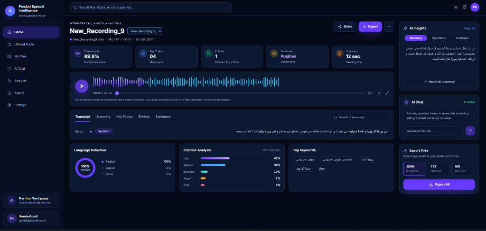
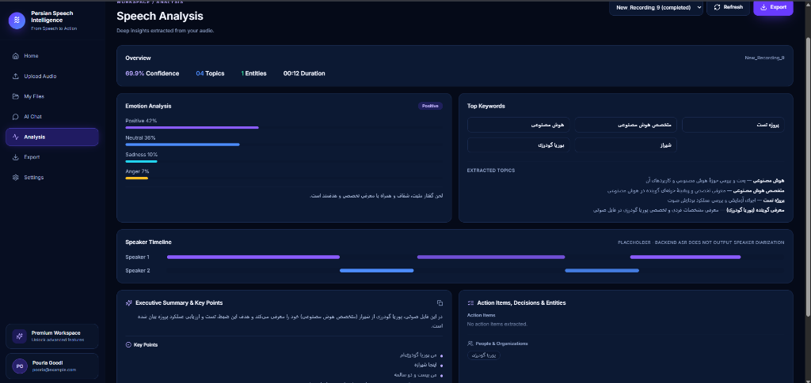
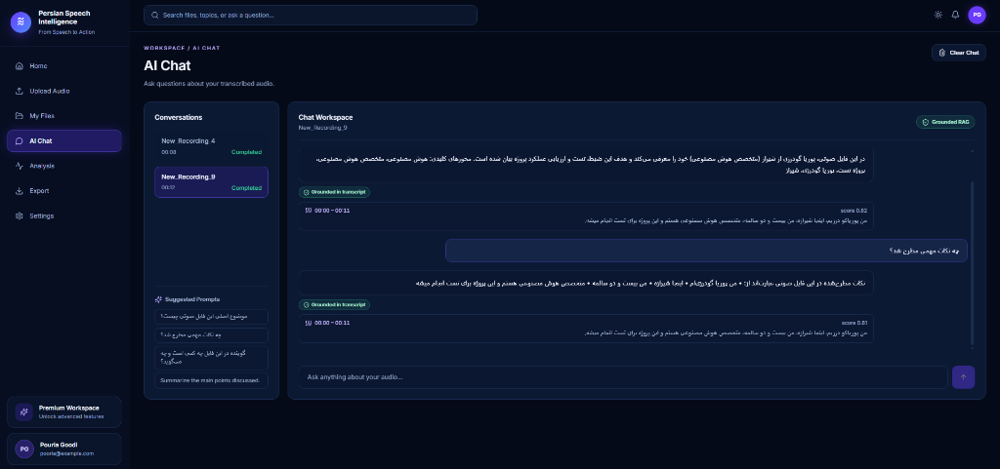

# Persian Speech Intelligence


AI-powered Persian speech analysis and conversational intelligence platform.

Upload Persian audio (meetings, interviews, lectures, support calls). The system transcribes speech, generates summaries, extracts structured information, analyzes transcript sentiment, and answers grounded questions over the recording.

Portfolio-ready AI engineering project: modular architecture, async processing, Docker, tests, and clear docs.

## Screenshots & Gallery

### Application UI

#### Audio Analysis Dashboard
Interactive waveform player, transcript display, Persian language detection, text-derived emotion analysis, and AI insights sidebar.



#### Deep Speech Analysis & Insights
Structured insights breakdown including topic extraction, emotion distribution, speaker timeline, executive summary, and action items.



#### Grounded AI Chat (RAG)
Conversational assistant grounded directly in the transcribed audio with timestamp and score citations.



## Main features

- Persian ASR with **Farsi fine-tuned Faster-Whisper large-v3** + rule/LLM polish
- Persian-aware transcript normalization
- **One combined LLM analysis call** (summary + topics + entities + sentiment) via **Qwen3-2B**
- Optional separate **Qwen3-4B** sentiment (off by default — avoids GPU model swap)
- Retrieval-augmented Q&A with **recording-level isolation** (e5-small + FAISS)
- Streamlit dashboard with RTL-friendly Persian UI
- FastAPI + PostgreSQL (or SQLite demo) + DB-backed worker
- Docker Compose, pytest, Ruff

## Example

Short Persian clip (ASR → analysis JSON):

**Transcript (example)**

```text
امروز می‌خوام در مورد هوش مصنوعی صحبت کنم.
شاخه‌های هوش مصنوعی، هوش مصنوعی شاخه داره، AI داره.
```

**Analysis output (shape matches the API / export)**

```json
{
  "short_summary": "گوینده درباره هوش مصنوعی و شاخه‌های آن و AI صحبت می‌کند.",
  "detailed_summary": {
    "main_discussion": "معرفی هوش مصنوعی و وجود شاخه‌ها و AI",
    "important_points": ["هوش مصنوعی شاخه دارد", "AI بخشی از بحث است"],
    "decisions": [],
    "action_items": [],
    "open_questions": [],
    "final_conclusions": ["موضوع اصلی هوش مصنوعی است"]
  },
  "topics": [
    {"name": "هوش مصنوعی", "description": "تعریف و شاخه‌ها"},
    {"name": "AI", "description": "اشاره به هوش مصنوعی"}
  ],
  "sentiment": {
    "label": "Neutral",
    "explanation": "لحن اطلاع‌رسانی و خنثی است."
  },
  "extracted_entities": {
    "keywords": ["هوش مصنوعی", "AI", "شاخه"],
    "people": [],
    "organizations": [],
    "tasks": [],
    "decisions": []
  }
}
```

**API flow**

```bash
# 1) Upload audio
curl -X POST "http://localhost:8000/api/v1/recordings" \
  -F "file=@./sample_data/audio/your_persian.wav"
# → { "id": "<RECORDING_ID>", "processing_status": "pending", ... }

# 2) After worker completes, fetch analysis
curl "http://localhost:8000/api/v1/recordings/<RECORDING_ID>/analysis"

# 3) Grounded Q&A
curl -X POST "http://localhost:8000/api/v1/recordings/<RECORDING_ID>/chat" \
  -H "Content-Type: application/json" \
  -d "{\"question\":\"موضوع اصلی صحبت چه بود؟\"}"

# 4) Export JSON / txt / markdown
curl -L "http://localhost:8000/api/v1/recordings/<RECORDING_ID>/export?format=json" \
  -o analysis.json
```

If evidence is missing, chat refuses in Persian:

> اطلاعات کافی برای پاسخ به این سؤال در فایل صوتی وجود ندارد.

More fixtures: `sample_data/finetune/` and [sample_data/README.md](sample_data/README.md).

## Repository layout

```
persian-speech-intelligence/
├── backend/           # FastAPI, worker, LLM, ASR, embeddings, tests
├── frontend/          # Streamlit UI
├── web/               # Modern React + Tailwind UI
├── training/          # LoRA fine-tuning scripts and configs
├── scripts/           # utilities, Tk test client
├── sample_data/       # fixtures / evaluation manifests
├── evaluation/        # ASR / retrieval / analysis eval scripts
├── docs/              # architecture, API, ASR, evaluation
├── storage/           # runtime uploads & vector indexes
├── docker-compose.yml
├── requirements.txt   # meta: -r backend + frontend
└── .env.example
```

## Architecture (runtime)

```
Upload → FastAPI → Storage + Job → Worker
                                   ├─ FFmpeg preprocess
                                   ├─ Farsi Faster-Whisper large-v3 (GPU)
                                   ├─ multilingual-e5-small + FAISS (CPU)
                                   └─ Qwen3-2B combined analysis / QA (GPU)
Read/Chat/Export ← FastAPI ← DB + indexes ← Streamlit
```

See [docs/architecture.md](docs/architecture.md). ASR details and fine-tuning: [docs/asr.md](docs/asr.md).

## Model defaults

| بخش | مدل پیشنهادی | محل اجرا |
|---|---|---|
| Speech-to-Text | Farsi Faster-Whisper large-v3 (`oi-uae/...`) | GPU |
| LLM | Qwen3-2B-Instruct-2507 (Q4) | GPU |
| Embedding | multilingual-e5-small | CPU |
| Reranker | فعلاً نیاز نیست | — |
| Sentiment Analysis | داخل همان درخواست ترکیبی (اختیاری: Qwen3-4B) | GPU |
| Vector Search | FAISS | CPU |
| Database | PostgreSQL | CPU |

## Requirements

- Docker + Docker Compose **or** Python 3.12, FFmpeg
- PostgreSQL 16 **or** SQLite for local demo
- NVIDIA GPU + CUDA recommended for Whisper / Qwen
- Local OpenAI-compatible endpoint (Ollama / llama.cpp / vLLM / LM Studio) serving Qwen3-2B

## Quick start (Docker)

```bash
cp .env.example .env
# Start local LLM with Qwen3-2B (Q4), then:
docker compose up --build
```

- API: http://localhost:8000/docs  
- UI: http://localhost:8501  
- Postgres: localhost:5432  

## Local development

```bash
cp .env.example .env
# Optional demo DB: set DATABASE_URL=sqlite:///./storage/psi_local.db

docker compose up -d db   # skip if using SQLite

cd backend
python -m venv .venv
.venv\Scripts\activate          # Windows
pip install -r ../requirements.txt
alembic upgrade head            # Postgres only
uvicorn app.main:app --reload --port 8000

# Worker (separate terminal, from backend/)
python -m app.workers.processing_worker

# Frontend
cd ../frontend
set BACKEND_URL=http://localhost:8000
streamlit run app.py
```

For ASR quality tests, upload your own Persian recordings (this project has no TTS stack).

## Environment

Important variables (see `.env.example`):

```env
WHISPER_MODEL=oi-uae/farsi-faster-whisper-large-v3
WHISPER_DEVICE=cuda
WHISPER_CONDITION_ON_PREVIOUS_TEXT=false
ASR_LLM_POLISH=true
EMBEDDING_MODEL=intfloat/multilingual-e5-small
EMBEDDING_DEVICE=cpu
LLM_PROVIDER=local
LOCAL_LLM_BASE_URL=http://localhost:11434/v1
LOCAL_LLM_MODEL=Qwen3-2B-Instruct-2507
LLM_TIMEOUT_SECONDS=300
LLM_MAX_TOKENS=1024
LLM_ANALYSIS_MAX_TOKENS=1536
SENTIMENT_USE_SEPARATE_MODEL=false
```

Analysis uses **one combined LLM request** by default. Set `SENTIMENT_USE_SEPARATE_MODEL=true` only when Qwen3-4B is already loaded.

## Usage (UI)

1. Open Streamlit at http://localhost:8501  
2. **Upload audio** → wait until status is `completed`  
3. Open **Speech analysis** / **Transcript** / **Ask AI** / **Export & settings**  
4. Download analysis JSON from Export (`format=json`)

The dashboard UI is English (LTR). Transcript / summary content stays in Persian when the audio is Persian.

API examples are in the [Example](#example) section above.

## Tests

Unit / API tests (no GPU required for most cases):

```bash
cd backend
set PYTHONPATH=.
pytest -q
```

Useful subsets:

```bash
pytest -q tests/test_asr_correct.py tests/test_persian_normalize.py
pytest -q tests/test_llm_json.py
pytest -q tests/test_config.py tests/test_health.py
pytest -q tests/test_recordings_api.py tests/test_retrieval_isolation.py
```

What the suite covers (see `backend/tests/`):

| Area | Examples |
|------|----------|
| ASR polish rules | `test_asr_correct.py` |
| Persian normalization | `test_persian_normalize.py` |
| LLM JSON schemas | `test_llm_json.py` |
| Config / health | `test_config.py`, `test_health.py` |
| Upload & jobs | `test_recordings_api.py`, `test_job_transitions.py` |
| RAG isolation | `test_retrieval_isolation.py`, `test_chunking_and_isolation.py` |

## Evaluation (optional labeled data)

```bash
# From repo root / with PYTHONPATH=backend
python evaluation/evaluate_asr.py
python evaluation/evaluate_retrieval.py
python evaluation/evaluate_analysis.py
python evaluation/evaluate_finetune.py --task asr_polish
python evaluation/evaluate_finetune.py --task analysis
```

Notebook GPU harness + quality metrics: [notebooks/README.md](notebooks/README.md)  
Methodology: [docs/evaluation.md](docs/evaluation.md) · LoRA fine-tune: [docs/finetune_llm.md](docs/finetune_llm.md)

## Security and privacy

- Private storage directories; no public static serving of uploads
- Secrets via environment only; optional `X-API-Key`
- Delete recording removes audio, transcript, analysis, and vector index

## Limitations

- Stock Whisper `medium` is weak on Persian tech talk — use the Farsi fine-tune (default) and `ASR_LLM_POLISH`
- Domain vocabulary may still need `WHISPER_HOTWORDS` / fine-tuning — see [docs/asr.md](docs/asr.md)
- Sentiment is **text-based**, not acoustic emotion recognition
- No reranker; no diarization / realtime streaming in MVP
- Local CPU-only setups will feel slow — GPU recommended

## License

MIT — see [LICENSE](LICENSE).
